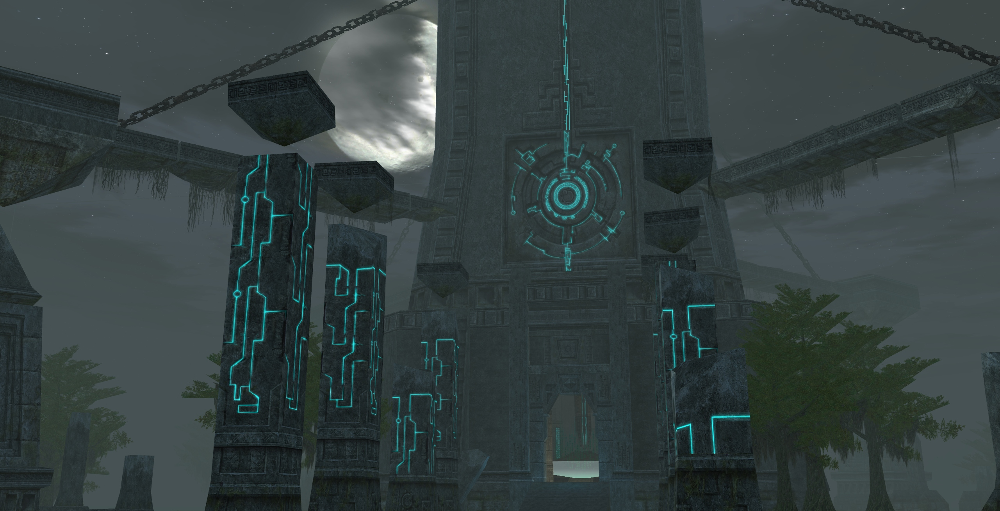
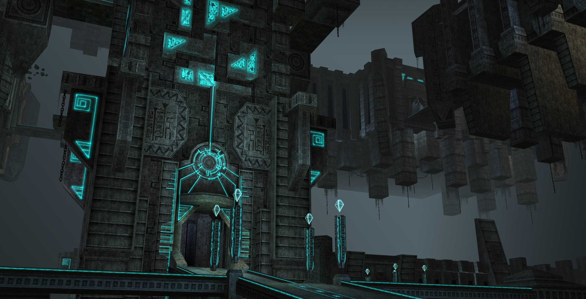
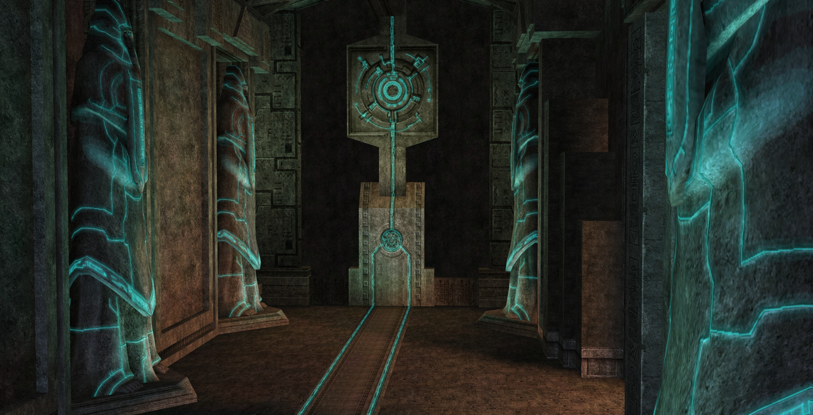

# A Lineage II Chronicle ~~3: Rise of Darkness~~ 4: Scions of Destiny client emulator for the browser

_At least it might be someday, hopefully._

## Why?
Modern Lineage II is a _mostly_ dead game full of bots and bad decisions made by NCSOFT. Even their attempts to provide a supposedly classical experience is filled with microtransactions, gameplay elements that prevent any type of punishment or even ban you from using chat until you reach a certain levels, these might have changed since the last time I played but it made me sad enough to just quit.

Private servers are also a soulless mess that die within a week after inception, have insane rates, can't decide decide if it's C6 or Interlude and generally outright refuse to run something older than Interlude.

This is an attempt to preserve an old game me and my friends used to love by porting it to TypeScript so that it could can run in the browser. This is not only an attempt to create an open-source interoperable client to preserve the game for the future but is also a way to allow more modding capabilities than were previously even possible by the limited toolsets that came out over more than a decade of the game lifespan.

## How?
This is the hard part. Re-creating a game client even if I had the original source code would already be a gradiose task, now imagine all I have is encrypted asset binaries. There exist some open source tools like _UEViewer_ that has greatly helped me to understand the binary layout, some things come directly from _UE4_ source code, although this is not as useful because a lot of _UE2_ things no longer exist in it. And then there's disassembly, it's slow and painful but it does the job.

I'm not a vanilla purist so if there's some data that's not critical but is hiding there in the binary, I will just skip it if it's possible to do without it.

## When?
It's here and it's working. There's always parity or performance issues left to resolve but otherwise I'm more than happy with the result. The road was long I started prototyping it rougly in December of 2020 and I had almost all of the required puzzle pieces already back 2022 but there was still so much work to be done but it finally all clicked into place.

## What's on the timeline?
On 2026-12-11 I'm doing a public test of the client in a vertical slice of the game (Talking Island) for everyone to join. The server will deliberatly only accept the web clients. After public test depending on the reception and how many issues come up I will decide on what parts need attention the most.

## Clanker notice
When I started researching and prototyping the asset viewer back in 2020 late clankers were just released and not even until recently everthing they did was extremly unreliable and for my use-cases pretty much useless, just a year ago the SoTA models struggled for two days to implement a basic rendering routine that I solved later in 10 minutes on pen & paper. Today's clankers while still somewhat abhorent in terms of quality and consistently introducing regressions, they excel at doing a verifiable tasks. I've had them tasked at extracting all the skills from the binaries which I could do myself but with just a couple hours a week at most would've taken me at least a year did it and they did it in a couple months. In addition they allowed me not to touch the one thing I hate the most - frontend. And because I pretty much got deeper knowledge of things I was interested in when originally starting the project (reverse engineering), I don't object using it for things I just don't care that much about (frontend). And while my plan for the future is to have only grass-fed human code, my current objective is just to get all the behaviour parity with real client since what's left is missing feature here and there, which will still take still quite a while but it's better to have a working client and tinker with it later than not to have one.

## Where are the assets? I want to see what's been done.
I don't know of the legality of providing assets, technically it wouldn't be piracy since the client itself was always free, but you'll have to locate, download and install the client. After which, just symlink it to the root project directory under `assets/`. The `stable` branch should functioning. Here are some previews:

## Why switch to C4?

This was actually a switch that was done couple years ago but I never updated the readme. It was mostly done because at the time it was easier to find a functioning client & L2J server combo. While it may not be permanent change, there are some codebase changes between C3 & C4 that are not fully compatibly although MOST of the stuff in C4 is forwards compatible to C3 so I may eventually switch back to C3 or support both.
